## 1. best-in-class call

A phone browser toolbar is not a keyboard. The drawer already ignores a viewport move under 64px when it pins to the keys. The open check did not, so a Brave tab whose toolbar leaves a 56px gap turned on `.is-keyboard-open`, dropped the resting foot to the keyboard pad, and left a window-level sheet at the layout bottom while the dock had already moved to the visual bottom.

The same 64px cutoff now decides both open checks. The viewport script publishes `--os-toolbar-bottom` for the gap only while it is under that cutoff, and 0 once a real keyboard is up, so the sheet does not jump for a frame when the keys open. The keyboard pin still writes inline `bottom: auto` and wins. Installed app, iPhone, and desktop measure a 0 gap, so their sheet stays where it was.

UX pass, phone and desktop. The page drawer still opens from Open page and still closes with Close page. The dock stays on the visual bottom. No new label, toast, or empty-state line. Nothing on the drawer says chain, gas, contract, or hash. Account ids stay whole. Chrome and Safari with no toolbar gap match the previous frame. Brave is Chromium with a faked 56px visual-viewport gap (Brave itself is not installed). Firefox on the Pixel profile got the same fake gap and the same result.

## 2. alignment map

The open check lives in `@onsocial/ui` `keyboard-drawer-frame.ts`. `keyboardViewportOpen` is the one predicate. `keyboardOpen` on `useKeyboardDrawerFrame` and `pageKeyboardLiftStyle` both use it. `keyboardDrawerFrameStyle` uses it too, so a toolbar does not also add a keyboard margin. The cutoff is `KEYBOARD_VIEWPORT_SLOP_PX` in `keyboard-viewport-slop.ts`. The blocking viewport script in `gate-viewport.ts` interpolates that same number into `--os-toolbar-bottom`. The dock keeps `--portfolio-dock-bottom` for the full overlap, including a real keyboard.

Non-hosted `.glass-sheet-root` in `glass-sheet.css` sets `bottom` to `--os-toolbar-bottom` and its safe-area foot to `max(0px, env(safe-area-inset-bottom) - that token)`. Hosted sheets (`.glass-sheet-root--hosted`) and bands are excluded. The page drawer on `/@alice.testnet` is hosted inside `.portfolio-frame`, which already uses `--portfolio-viewport-height`, so its panel already met the dock. The class fix is what restores that drawer's foot. A sheet portaled to the window is the one the bottom pin moves.

These still treat any positive lift as a keyboard, on purpose for this change: `use-page-keyboard-lift.ts`, `commerce-sheet-keyboard.ts`, and the write dock, messages, guild composer, and endorse callers that pass their own `keyboardOpen`. They do not own the page drawer. `keyboardDrawerFrameStyle` no longer margins them for a sub-64px overlap.

Tokens stay the ones already on the sheet: `--os-toolbar-bottom`, `--portfolio-dock-bottom`, `--os-sheet-footer-pad-bottom`, `env(safe-area-inset-bottom)`. No new length.

## 3. near idioms

No wallet, account, contract, gas, or storage change. The failure is the phone viewport while a drawer is open and no field is focused. Names on the drawer stay ordinary text. No chain wording is added to the screen. No glossary terms. Open page and Close page are unchanged.

## 4. side effects

On a phone, a non-hosted sheet's bottom edge follows the toolbar gap the dock already uses. While a real keyboard is up, that token is 0 and the existing inline pin (`bottom: auto`, padding 0, height of the visible viewport) is the only move. Hosted sheets, including the page drawer, keep `inset: -1px` and follow the portfolio frame. A 56px toolbar no longer adds `.is-keyboard-open` on a `GlassSheet`, so the foot stays on `--os-sheet-footer-pad-bottom` (0.55rem plus the safe area) instead of the keyboard pad (0.45rem).

Portal does not publish `--os-toolbar-bottom`, so the fallback is 0 and a portal sheet does not move. A portal or commerce sheet no longer takes a keyboard margin for an overlap under 64px. Desktop, a zero gap, and an installed app (the measured gap is 0) keep the hosted inset and the resting foot. The close control and the drag handle stay on the drawer.

## 5. shipped

`keyboardViewportOpen` is the shared `>= 64` check for `keyboardOpen`, `pageKeyboardLiftStyle`, the keyboard pin, and `keyboardDrawerFrameStyle`. `gate-viewport.ts` publishes `--os-toolbar-bottom` before paint. Non-hosted `.glass-sheet-root` uses it for `bottom` and for the safe-area foot. Playwright `brave-drawer-gap` reuses `stubShorterVisualViewport`: a 56px gap on iPhone, Samsung, and Pixel, a 300px keyboard on Pixel, and a zero gap on a phone plus desktop.

Screenshots are the page drawer on `/@alice.testnet`. Chrome is Playwright Chromium with no stub. Safari is Playwright WebKit with no stub. Brave is Playwright Chromium with a faked 56px `visualViewport` shortfall and a Brave user agent. Brave is not installed. Firefox on the Pixel profile got the same stub. Viewports are profiles, not devices: iPhone 390×844, Samsung 360×780, Pixel 412×915, desktop 1280×800. Safe area in this emulation is 0, so the resting root foot is 0. The hosted panel is 2px larger than its card because the hosted root is `inset: -1px`. That 1px past the dock is the existing hairline, before and after.

The hosted page drawer already ended on the visual bottom, because the portfolio frame tracks it. What changed on that drawer is the keyboard class and the foot. What changed for a window-level sheet is `bottom`: 0 before, 56px after, level with the dock.

| Device | Browser | Gap | Phase | Panel w×h | Panel bottom | Dock bottom | Visual bottom | Panel−dock | Keyboard class | Foot vs resting | Window-sheet bottom |
| --- | --- | --- | --- | --- | --- | --- | --- | --- | --- | --- | --- |
| iPhone | Chrome | 0 | before | 392×846 | 845 | 844 | 844 | 1 | off | 8.8 = 8.8 | 0 |
| iPhone | Chrome | 0 | after | 392×846 | 845 | 844 | 844 | 1 | off | 8.8 = 8.8 | 0 |
| iPhone | Safari | 0 | before | 392×846 | 845 | 844 | 844 | 1 | off | 8.8 = 8.8 | 0 |
| iPhone | Safari | 0 | after | 392×846 | 845 | 844 | 844 | 1 | off | 8.8 = 8.8 | 0 |
| iPhone | Brave (stub) | 56 | before | 392×790 | 789 | 788 | 788 | 1 | on | 7.2 vs 8.8 | 0 |
| iPhone | Brave (stub) | 56 | after | 392×790 | 789 | 788 | 788 | 1 | off | 8.8 = 8.8 | 56 |
| Samsung | Chrome | 0 | before | 362×782 | 781 | 780 | 780 | 1 | off | 8.8 = 8.8 | 0 |
| Samsung | Chrome | 0 | after | 362×782 | 781 | 780 | 780 | 1 | off | 8.8 = 8.8 | 0 |
| Samsung | Safari | 0 | before | 362×782 | 781 | 780 | 780 | 1 | off | 8.8 = 8.8 | 0 |
| Samsung | Safari | 0 | after | 362×782 | 781 | 780 | 780 | 1 | off | 8.8 = 8.8 | 0 |
| Samsung | Brave (stub) | 56 | before | 362×726 | 725 | 724 | 724 | 1 | on | 7.2 vs 8.8 | 0 |
| Samsung | Brave (stub) | 56 | after | 362×726 | 725 | 724 | 724 | 1 | off | 8.8 = 8.8 | 56 |
| Pixel | Chrome | 0 | before | 414×917 | 916 | 915 | 915 | 1 | off | 8.8 = 8.8 | 0 |
| Pixel | Chrome | 0 | after | 414×917 | 916 | 915 | 915 | 1 | off | 8.8 = 8.8 | 0 |
| Pixel | Safari | 0 | before | 414×917 | 916 | 915 | 915 | 1 | off | 8.8 = 8.8 | 0 |
| Pixel | Safari | 0 | after | 414×917 | 916 | 915 | 915 | 1 | off | 8.8 = 8.8 | 0 |
| Pixel | Brave (stub) | 56 | before | 414×861 | 860 | 859 | 859 | 1 | on | 7.2 vs 8.8 | 0 |
| Pixel | Brave (stub) | 56 | after | 414×861 | 860 | 859 | 859 | 1 | off | 8.8 = 8.8 | 56 |
| Pixel | Firefox (stub) | 56 | before | 414×861 | 860 | 859 | 859 | 1 | on | 7.2 vs 8.8 | 0 |
| Pixel | Firefox (stub) | 56 | after | 414×861 | 860 | 859 | 859 | 1 | off | 8.8 = 8.8 | 56 |
| Pixel | Chrome | 300 | after | 414×615 | 615 | 615 | 615 | 0 | on | keyboard pin | 0 (token) |
| Desktop | Chrome | 0 | after | 576×800 | 800 | 800 | 800 | 0 | off | 8.8 = 8.8 | 0 |
| Desktop | Safari | 0 | after | 576×800 | 800 | 800 | 800 | 0 | off | 8.8 = 8.8 | 0 |

The 300px row is a real keyboard. Inline `bottom` is `auto`, inline padding is 0, `--os-toolbar-bottom` is 0, and `--portfolio-dock-bottom` is 300px. The sheet is pinned to the visible 615px, not jumped by the toolbar token. Desktop root `bottom` stays `-1px` (the hosted inset). A zero gap on the phone matches that same hosted inset.

Pixel, the drawer people will compare. Chrome and Safari have no toolbar stub. Brave is the stub.

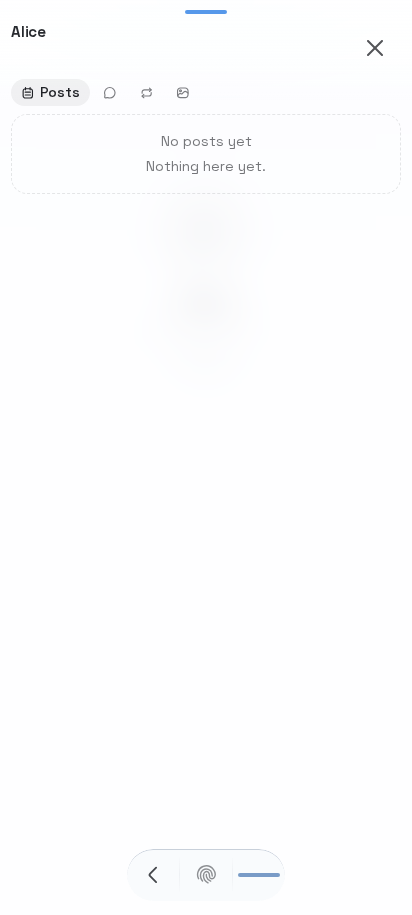

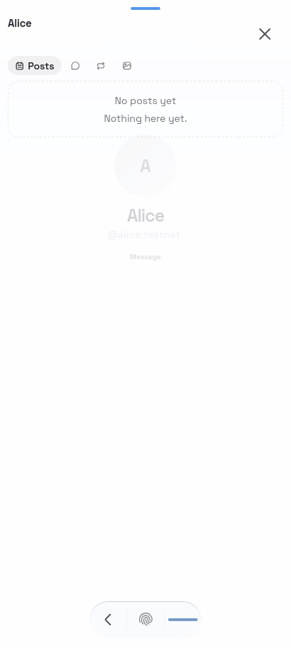

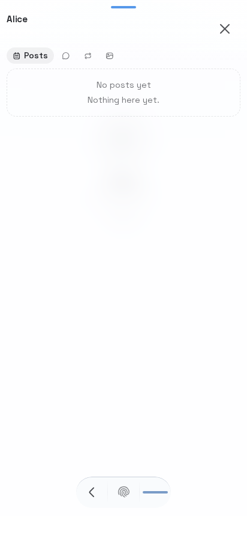

iPhone.

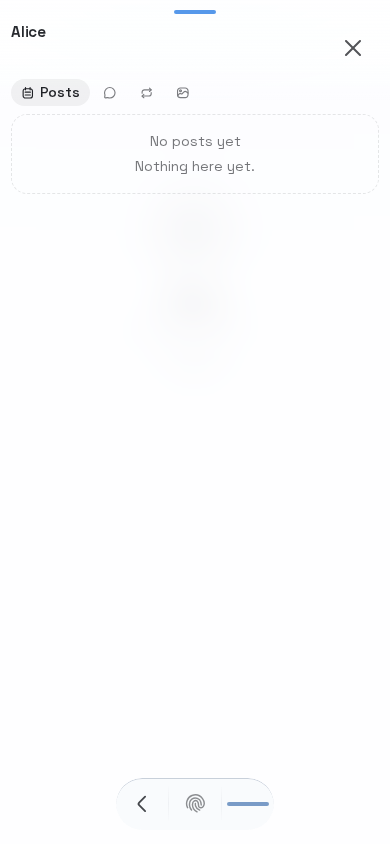

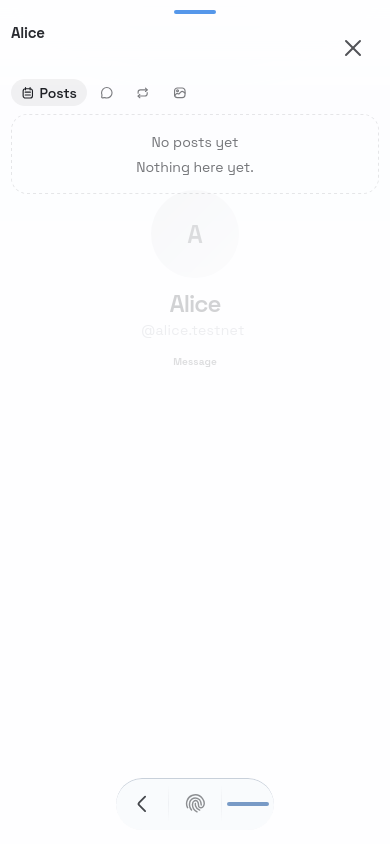

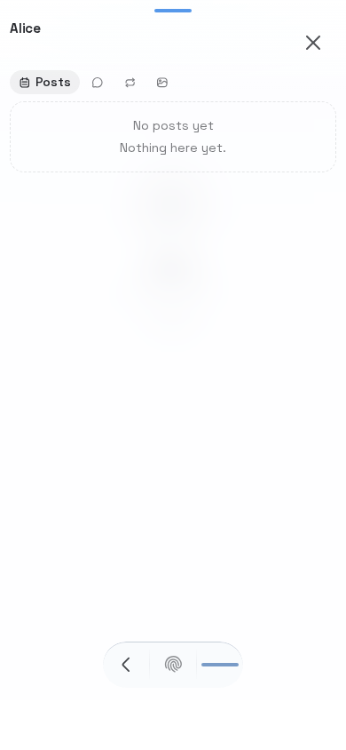

Samsung.

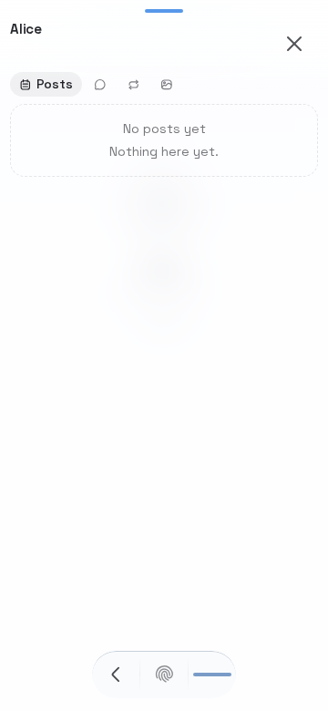

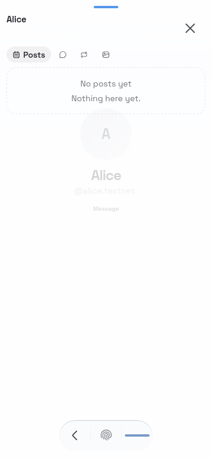

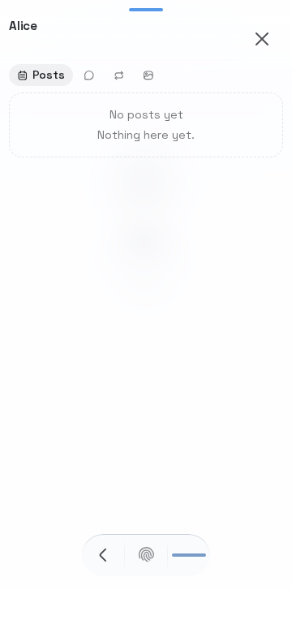

Firefox on Pixel used the same 56px stub. It is not one of the three requested browsers.

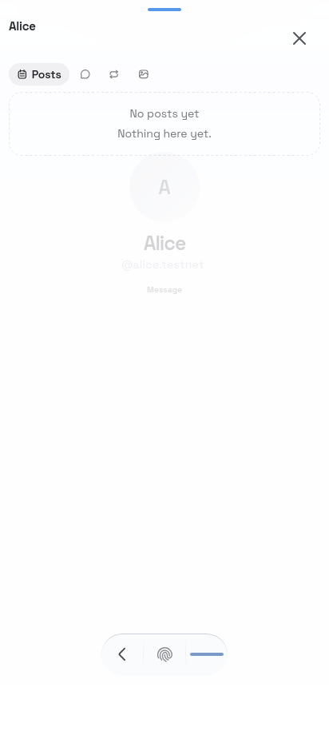

A 300px keyboard still pins. Desktop with no gap stays on the hosted inset.

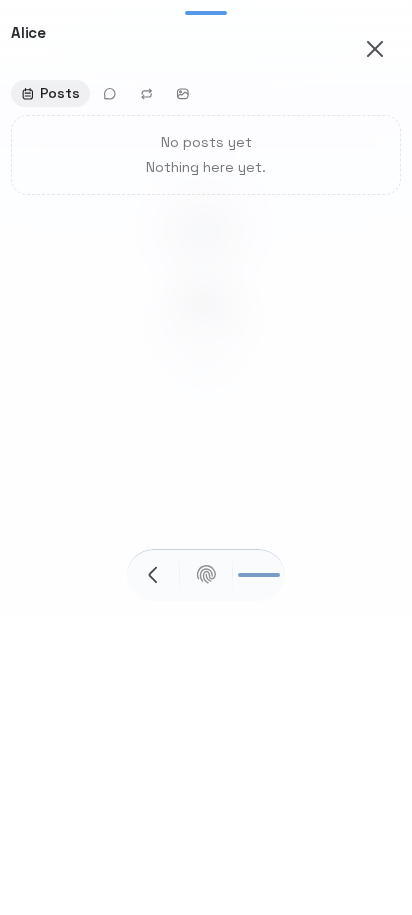

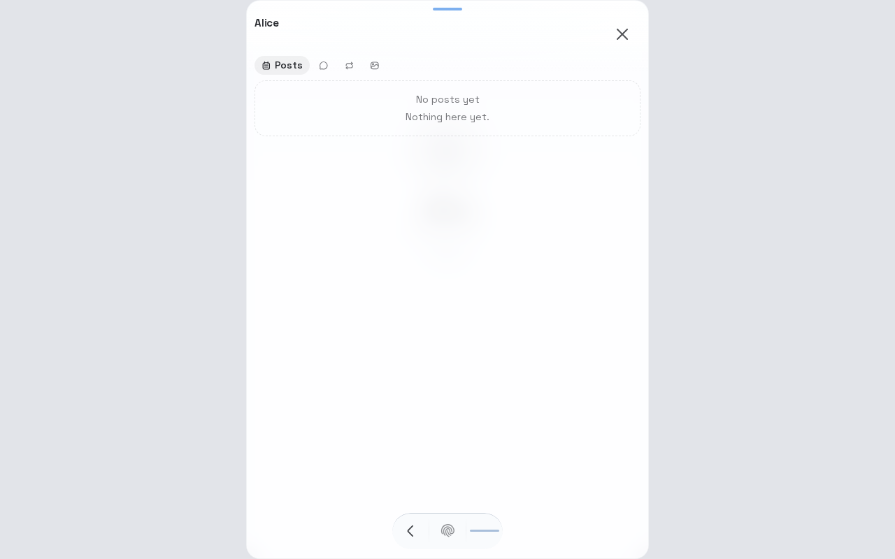

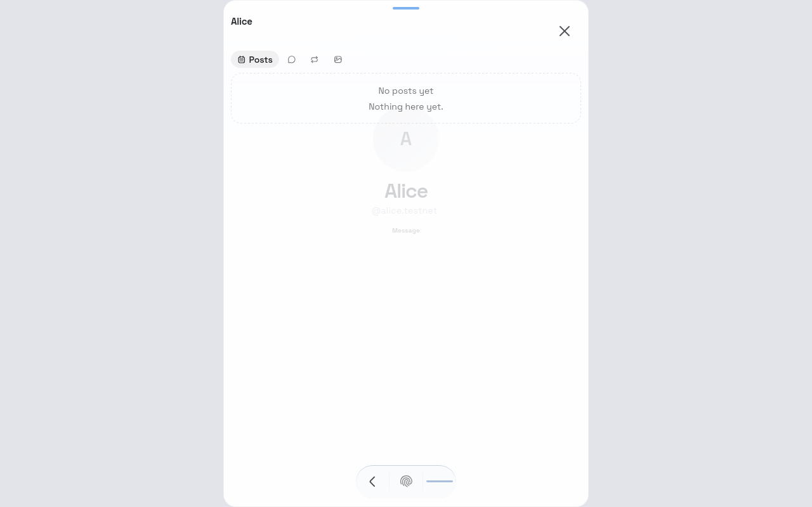

No new user-facing strings, so no glossary terms. A real Brave device was not available.
