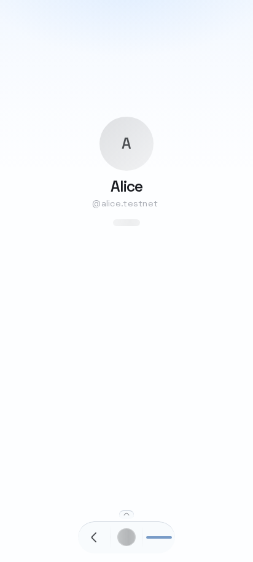
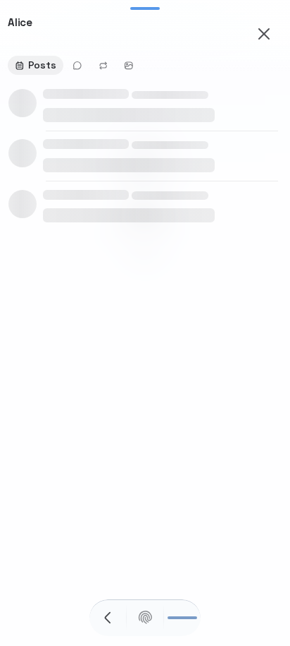
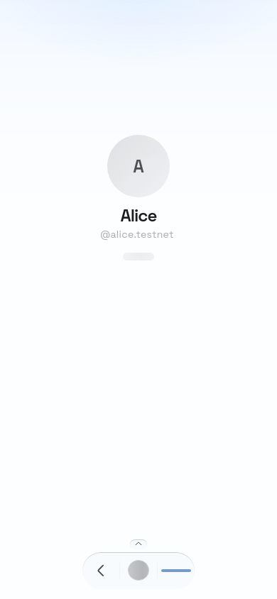
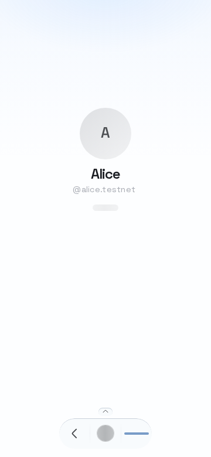
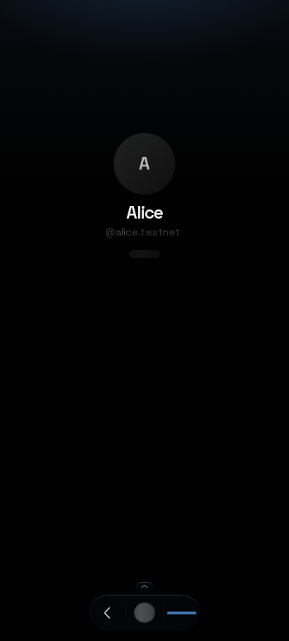
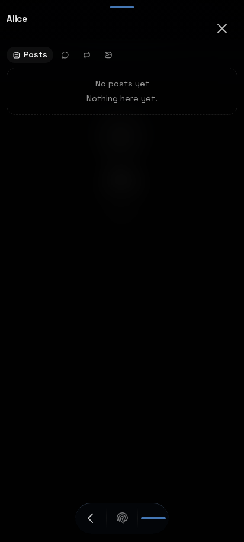

## 1. best-in-class call

The empty band under the page drawer in a normal Brave tab is not something this change can pin from the source. The drawer is hosted in the portfolio frame, and the only length that shortens that frame is `--portfolio-viewport-height`. Whether Brave’s visible bottom sits below that length depends on what the tab reports for `innerHeight`, `visualViewport`, and `safe-area-inset-bottom`. Those numbers are not in the repo. A Brave-only guess would be a second behavior for one browser. This change does not guess. It adds a temporary readout so a real tab can send the numbers.

## 2. alignment map

The page drawer is `PageContentDrawer` → `GlassSheet` with `keepDock`. It portals into the portfolio card, so the root is `.glass-sheet-root.glass-sheet-root--hosted`, not a window-fixed sheet.

What sets the bottom of that drawer:

1. `gate-viewport.ts` sets `--portfolio-viewport-height` to `visualViewport.offsetTop + visualViewport.height`, and `--portfolio-dock-bottom` to `innerHeight - that`.
2. `.portfolio-frame` uses that height for `height`, `min-height`, and `max-height` (`globals.css`). The frame cannot grow past it.
3. The hosted root is `position: absolute; inset: -1px; padding: 0` (`glass-sheet.css`). The page drawer panel is `height: 100%` (`.page-drawer-panel` in `globals.css`). The panel fills the frame. Its bottom is the frame’s bottom.

What does not create that gap:

- `.glass-sheet-root` safe-area padding does not apply. The hosted rule sets `padding: 0` and wins.
- `.glass-sheet-root[data-keep-dock='true'] { padding-bottom: var(--portfolio-dock-clearance) }` is inside `@layer components` (the block that starts near the summon dock). Unlayered hosted `padding: 0` beats it. A measured hosted root had `padding-bottom: 0`.
- `.page-drawer-body` padding-bottom is `0`. The page drawer has no footer, so `--os-sheet-footer-pad-bottom` (which does include `safe-area-inset-bottom`) is not on this surface.
- The dock’s own `padding-bottom` is `var(--os-dock-bottom-offset) + env(safe-area-inset-bottom)`, inside the dock. It does not shorten the drawer.
- The last attempt pinned non-hosted `.glass-sheet-root` to a toolbar token. This drawer is hosted, so that pin never moved it. That attempt is reverted.

The strip under the panel, when it exists, is the page below the frame. Its size is `innerHeight - (offsetTop + visualViewport.height)`, which is also `--portfolio-dock-bottom`. The dock is `bottom: var(--portfolio-dock-bottom)`, so the dock sits on the frame, not in the strip. The strip is visible only when the tab paints below the visual bottom. Chrome, Safari, Samsung, and the installed app do not show it. The source does not say whether Brave’s layout viewport is already the visible screen while `visualViewport` is shorter again, or whether `safe-area-inset-bottom` is a second copy of the same toolbar. Both would look like a gap. Only a device readout can tell them apart.

This branch does not change that token, the dock, the pill, the sheet padding, or the keyboard frame. A later fix that does change `--portfolio-viewport-height` or `--portfolio-dock-bottom` moves every surface that lives in the portfolio frame:

- Face and pill. The pill is the Open page button in `.portfolio-summon-dock`. The dock’s bottom is the token. Its padding adds `--os-dock-bottom-offset` and `safe-area-inset-bottom` inside the dock, not under the drawer.
- Page drawer. `page-content-drawer.tsx`.
- Page sheets on that card. `os-page-sheet.tsx`, including the portfolio glass host.
- Gesture sheets. `os-gesture-sheet.tsx`: endorse compose, endorsement focus, support, scarce buy, sell, bid, offer, list, offers, transfer, protocol task.
- Hug sheets. `os-hug-sheet.tsx`, and the choice, action, info, and discard drawers that use it. That is the facts, settings, token, drop, collection, guild, and list hugs.
- Direct sheets on the card. Mood sheet, rally sheet.
- Protocol face pair. It uses the same height token.

Every one of those is hosted, so a change to non-hosted `.glass-sheet-root` padding does not move them. The logged-out gate uses `--gate-viewport-height`, a different token, and a frame fix would leave it alone. `useKeyboardDrawerFrame` still runs inside every `GlassSheet`. This branch does not change it. Keyboard open still means a real overlap, not a toolbar.

## 3. near idioms

No wallet, account, contract, gas, or storage change. The readout is a temporary diagnostic. Its only new word is Copy, on that panel. No glossary term. The drawer’s own names are unchanged.

## 4. side effects

No layout rule changes. Chrome, Safari, Samsung, and the installed app keep the frame and the dock they have now. `?viewport-debug=1` shows a fixed readout at the top of the screen and stores the choice in `sessionStorage` for the tab. `?viewport-debug=0` clears it. The panel uses the stamp size, the gutter, the column width, and the solid glass fill. It does not move the drawer.

Temporary, remove before merge:

- `packages/onsocial-app/src/components/viewport-debug/viewport-debug-overlay.tsx`
- `packages/onsocial-app/src/components/viewport-debug/viewport-debug-overlay.css`
- `packages/onsocial-app/src/components/viewport-debug/viewport-debug-flag.ts`
- `packages/onsocial-app/src/components/viewport-debug/viewport-debug-flag.test.ts`
- the `ViewportDebugOverlay` mount in `app-providers.tsx`

## 5. shipped

Against `main` this branch is a readout and this brief. No production layout file changes. The keyboard-threshold and toolbar-token attempt is reverted, including its screenshots.

No fix. The cause cannot be confirmed from the code alone, so nothing speculative was left in `gate-viewport.ts`, `glass-sheet.css`, or the keyboard frame. The keyboard-threshold and toolbar-token attempt is reverted, including its screenshots. The size of a fix was not the reason it was left out. A longer change would ship if the trace named one inset. It names the frame height, and then stops, because Brave’s reported heights are not in the source.

The temporary readout lists `innerHeight`, `innerWidth`, `clientHeight`, visual viewport height / offsetTop / pageTop / scale, screen height and availHeight, device pixel ratio, safe-area top and bottom, `100vh` / `100svh` / `100lvh` / `100dvh`, standalone, a short user agent, Brave (`navigator.brave`, then `isBrave()` when it exists), `--portfolio-dock-bottom`, `--portfolio-viewport-height`, measured lift, keyboard lift, keyboard-open, and when a drawer is open the root, panel, footer, and dock boxes plus root and footer padding-bottom and the gap under the panel. Copy writes that snapshot as JSON.

What would decide a later fix, from that JSON:

- Gap under the panel equals `measuredLift`, and safe-area bottom is 0: the frame was shortened to the visual bottom and that strip is still on screen. The frame should stay on the layout height for that tab.
- Gap equals safe-area bottom, and lift is 0: the safe area is the whole gap. It is not currently on this hosted root.
- Gap equals lift plus safe-area bottom: both are applied. Today only the lift shortens this drawer, so a sum that large means another inset this trace did not find.
- Lift is 0 and the frame token equals `innerHeight`: the gap is not this frame. Look at `drawerRootPaddingBottom` and `drawerPanel.bottom`.

Resting layout on this branch, no toolbar stub. The readout is off. Chrome is Chromium. Safari is WebKit. Samsung is the Samsung viewport in Chromium, because Samsung Internet is not installed. The installed app is Chromium with `display-mode: standalone`. Frame bottom meets the dock. The drawer panel is 1px past that, the hosted `inset: -1px`. Root padding is 0. Nothing here moved relative to `main`, because the layout files match `main`.

| Profile | Frame | Dock bottom | Panel bottom | Gap under frame | Root pad |
| --- | --- | --- | --- | --- | --- |
| Chrome, Pixel 412×915 | 915 | 915 | 916 | 0 | 0 |
| Safari, iPhone 390×844 | 844 | 844 | 845 | 0 | 0 |
| Samsung viewport, 360×780 | 780 | 780 | 781 | 0 | 0 |
| Installed app, Pixel 412×915 | 915 | 915 | 916 | 0 | 0 |

Chrome, face and drawer.

Safari, face and drawer.

Samsung viewport, face and drawer.

Installed app, face and drawer.

