## 1. best-in-class call

Settings Allow and Renew should add the same kind of key onboarding already adds. The account is the predecessor on `execute`, and the contract treats that account as allowed on its own tree. A second `execute_admin` `set_key_permission` does not grant the owner anything the key does not already have. It does attach 100 TGas. At the minimum gas price that is 0.01 NEAR, which does not fit in the welcome top-up once the sponsored allowance (0.008 NEAR) and the AddKey fee headroom (0.002 NEAR) are counted against the 0.013 NEAR threshold.

The call is one AddKey for an owner app session, then the same persist onboarding uses. Delegated and cross-account grants still write `set_key_permission`. That API stays.

When this device has no app access, the wallet drawer shows one compact `OsNoticeCard` above the balance. It uses the amber attention tokens and the same Allow / Renew handler as the App access sheet. It paints only after the session check has finished, and it reserves no space before that. The App access row stays, without the amber highlight.

A funded first visit should approve the key inside the same sign-in. The welcome drip and AddKey are different signers, so an unfunded first visit still signs in first. The account id is not in local storage on a first visit. It is knowable only when the chosen wallet will name it after the picker and before sign-in (`getAccounts`). When the wallet will not name it, sign-in stays without the key so an empty account can still connect. That case is two approvals even when the balance turns out to be enough. near-connect already filters the wallet list with `signInWithFunctionCallKey` when the key is bundled. A first visit has already picked a wallet, so that wallet has to advertise the feature or the key stays off the first sign-in.

## 2. alignment map

Owner vs delegated plan: `packages/onsocial-sdk/src/advanced/session.ts` (`isOwnerAccountScope`, `buildSessionGrant`, `buildSessionRevoke`). An owner path is the signer account or a path under it (`alice.near/`, `alice.near/profile`). `apps/myapp/` and `bob.near/` stay delegated. A storage deposit on an owner path is still included. Only the permission action is dropped. `packages/onsocial-sdk/src/advanced/bootstrap.ts` skips the wallet call when that plan has no actions (owner key already on the account, AddKey omitted). `revokeSession` passes the signer account, so an owner remove is DeleteKey only.

Settings and onboarding: `packages/onsocial-app/src/lib/app-social-session.ts`. `appSessionKeySpec` is the one description of the owner key (core `execute`, allowance from the sponsor helper). Onboarding still sends it through `connect({ addFunctionCallKey })`. Settings Allow and Renew send the same spec as one AddKey via the connected wallet, then `commitOwnerAppAccess` → `persistSessionFromKey`. Renew reuses the stored key. If that key is still on the account, commit only refreshes the local 90-day expiry.

Sponsor: `packages/onsocial-app/src/lib/app-session-sponsor.ts` (`ADD_KEY_FEE_HEADROOM_YOCTO`, `PERMISSION_WRITE_GAS_YOCTO`). `packages/onsocial-app/src/lib/welcome-near.ts` `fundAppSessionIfNeeded` re-reads the balance when the sponsor does not drip, and throws if the account is still under the threshold. The relayer and `packages/onsocial-backend/src/routes/welcome-near.ts` are unchanged.

Copy: `packages/onsocial-app/src/lib/wallet-errors.ts` `mapAppAccessError`, `txToastError.allowAppAccessFailed` in `transaction-toast-copy.ts`, used by `app-access-sheet.tsx`. `docs/glossary.md` records App access and the failure line.

First connect: `resolveAppConnectRoute` in `packages/onsocial-app/src/lib/app-session-sponsor.ts` bundles whenever the account does not need the drip and this is not the switch-wallet picker. `hasStoredHint` no longer blocks a funded first visit. `walletMayBundleSessionKey` keeps the returning path on the wallet-list filter, and requires `signInWithFunctionCallKey` on the already chosen wallet for a first visit. `resolveBundledAppConnect` in `app-wallet-context.tsx` takes that account id, stored or previewed. A first visit calls `selectWallet`, peeks `getAccounts`, then `connect({ walletId, addFunctionCallKey })` only when the peek is funded and the wallet can add the key. The same pending key and `completeAppSessionAfterConnect` path finish it. The e2e stand-in is `createE2eFirstConnectConnector` in `e2e-mock-signer.ts`.

Wallet drawer neighbours, read with the parent `GlassSheet` (`app-account-sheet.tsx`, `sizing="hug"`, `initialDetent="full"`, `panelClassName` `account-drawer-panel os-sheet-cap-tall`):

- Grip: `.glass-sheet-grip` inside `.glass-sheet-drag` (`glass-sheet.css`). Width `--os-grip-width` (`2.25rem`), thickness `--os-grip-thickness`. Hover opacity `0.65`, `:active` opacity `0.8` and `scaleX(1.05)`. The banner does not replace it.
- Close: `SheetChromeHeader` → `SheetCloseButton` (`MultiplyIcon` in `OsIconAction`), `closeAriaLabel="Close"`. Header pad is `0 var(--os-sheet-pad-inline) 0.75rem`. Measured hit `38×38`.
- Identity: `.account-drawer-avatar` (kit avatar, `size="md"`), `.account-drawer-name` (`1.05rem`, `--os-identity-name-weight`), `.account-drawer-face:focus-visible` uses `--os-surface-ring`. Copy control is `.account-drawer-handle` with `CopyIcon` / `CheckIcon` from `@onsocial/ui`. Thumb target `2.75rem`.
- Safe area: the glass sheet pads with `env(safe-area-inset-*)`. Inline pad is `--os-sheet-pad-inline`, which is `--os-gutter` (`0.75rem`). The hosted root uses `inset: -1px`, so the panel's bottom measures 1px past the layout viewport.
- Dock: `.portfolio-summon-dock` is `position: fixed`, `z-index: 40`, bottom `--portfolio-dock-bottom`. While a glass sheet is open, `body:has(.glass-sheet-root) … .portfolio-summon-dock` sets `opacity: 0` and `translateY(100% + safe-area)`. Measured opacity `0`. The sheet z-index is `SHEET_Z.account` (55). The banner is inside the sheet body, not on the dock.
- Balance: `#account-sheet-wallet-zone` / `.account-card-wallet-zone` (`os-surface-panel`, pad `0.55rem 0.65rem`, gap `0.5rem`). Kicker `.account-card-balance-kicker`, value `.account-card-balance-value`, unit `.account-card-balance-unit`. Get SOCIAL is an `OsSheetAction` primary. Collect is `.account-wallet-action.os-surface-chip`, disabled until a claim is ready. Activity uses `--os-stamp-size` and `--protocol-green` when ready. Storage strip uses the existing attention wash when storage is low. The Account row under the zone is `.os-surface-row` with `ChevronRightIcon`.
- Column: `.account-card` is a column with gap `0.65rem` (`0.5rem` under `42rem` height). The banner is the first child, so that gap is the space before the balance. Nothing new is reserved when the card returns null.
- Cap: `os-sheet-cap-standard` is `min(88dvh, 36rem, 100%)` (576px). The notice plus the wallet column is taller than that, and the Account row's bottom sat past the panel. The drawer now uses `os-sheet-cap-tall`, the existing editor/commerce cap `min(94dvh, 46rem, 100%)`. Hug still sizes to the content, so a drawer with no notice stays the shorter height. With the notice showing, the body does not scroll (`scrollHeight` equals `clientHeight`).
- App access row: `AccountShortcutDock` in the Account menu, not the drawer body. It keeps the label and the “Allow this device” hint. `tone="attention"` is gone, so it no longer uses the amber row wash (`color-mix` of `--protocol-amber` at 8% / 14%, ink `--protocol-amber-ink`).

Icons already on this surface: `MultiplyIcon` (close), `CopyIcon` / `CheckIcon` (handle), `ChevronRightIcon` (Account). The notice pattern does not carry an icon.

Notice cards in the repo (`OsNoticeCard`):

- Log out, in this same account family (`account-card-parts.tsx`): `align="start"`, no `shell`, no icon, title + body, footer `OsSheetActions layout="row" tone="frosted-primary" borderless`. Pending dots on the commit button. Cancel is `disabled` while that runs. Focus, hover, and press come from `OsSheetAction` (`:focus-visible` uses `--os-focus-ring`, `:active` and `:disabled` are in `os-sheet-action.css`).
- Profile load error (`profile-editor-load-error.tsx`): `align="center"`, `shell`, one primary in a stack, no icon. Different surface.

Neither notice carries an icon. The banner's card contains no `svg`. It uses the log-out structure: start align, no shell, the same footer. Spacing is the kit card (`.os-notice-card` gap `0.7rem`, pad `0.9rem 0.9rem 0.75rem`), not a second pad. The only added rule is `.os-notice-card--attention`: fill `--protocol-amber-bg`, title and body `--protocol-amber-ink`. Those tokens swap under `[data-theme='dark']` (`protocol.css`). `--protocol-amber` stays the hue; ink is the text color because the hue fails contrast on a light surface. The resting button is `os-sheet-action os-sheet-action--primary is-ready` and is not `disabled`. While the grant runs it is `pending` and `disabled` together, which is the kit dots state. Focus, press, and disabled styling stay in `os-sheet-action.css` (`:focus-visible` uses `--os-focus-ring`). No new pressed, focus, or loading styles.

Re-scan after the edits: community handoff still calls `grantCommunityAppSession` → `buildSessionGrant` with `apps/<id>/`, so that grant still emits AddKey and `set_key_permission`. Portal welcome-near is a separate helper and was not retargeted. Switch wallet still calls `connect({})` with no key. An already connected `connect()` still resumes through `ensureSocialSession` and does not bundle into that resume.

## 3. near idioms

AddKey installs a function-call access key on the signer, receiver `core`, method `execute`, allowance chosen by `chooseSessionKeyAllowanceYocto`. That is the native scope. The contract’s execute context is the predecessor (`contracts/core-onsocial/src/state/execute/auth.rs`). `has_account_permissions` returns immediately when the grantee is the account (`domain/groups/permissions/kv/eval.rs`). `set_key_permission` remains the way to authorize a key on a path that account does not own. Sandbox coverage of an owner function-call key writing with no permission row is `tests/src/key_permissions_tests.rs` (`test_session_key_access_key_can_call_set_without_wallet`).

The 90-day expiry for an owner app key is local session metadata. It is not a chain permission TTL. Renew of a key that is still on the account does not submit a transaction. User cancel stays quiet (`isWalletUserCancellation`), including a rejected wallet list. The toast does not say gas, on-chain, contract, or transaction hash.

`signInWithFunctionCallKey` is the wallet feature that adds the function-call key during sign-in. The balance check uses `accountNeedsAppSessionSponsor` and `WELCOME_NEAR_THRESHOLD_YOCTO` (0.013 NEAR). That is the existing “enough to skip the drip” line. It is above key storage (~0.00139 NEAR) plus the AddKey fee, so no new threshold was added. A balance that is unknown (`getAccounts` empty or thrown) is treated as “do not bundle.”

## 4. side effects

Allow on a missing key is one wallet confirmation. The action list is a single AddKey. Renew of a key that is still on the account shows success and does not open the wallet. Renew of a key that is gone sends AddKey for that same key, not a second key. If AddKey is submitted but the key is not visible yet, the pending secret is kept so the next Allow retries the same key.

Remove of an owner app key is DeleteKey only. A permission row written by an older Allow is not cleared. Level 0 revoke of a missing row is a no-op on the contract, and a deleted key cannot sign, so the leftover row does not authorize anything. It expires with the timestamp that was stored, or it sits unused. Delegated revoke still clears the row.

`fundAppSessionIfNeeded` no longer returns when the sponsor is off, reports a sufficient balance, or declines to drip, if a fresh read is still under 0.013 NEAR. A real drip still waits for that balance and throws if it never arrives. An account that is already over the threshold does not call the sponsor. The welcome route and the relayer are untouched.

Onboarding’s connect options are built from the same key spec. A connected empty account still gets the setup toast, then AddKey. The failure toast for Allow, Renew, and Remove is the glossary line, including when the wallet error mentions gas or the chain. A submitted transaction that later fails confirmation still goes through the shared confirmation hook, which can surface the receipt text.

A funded first visit whose wallet names the account sees one sign-in, and that sign-in includes the key. An unfunded first visit sees a sign-in without the key, then the drip, then a second sign-in for the key. A first visit whose wallet will not name the account also signs in without the key. If that account is funded, the follow-up AddKey is a second approval. Returning funded connects are unchanged: the key is still inside the first `connect`, and the wallet list is filtered to wallets that support the feature. The switch-wallet picker still does not bundle.

The banner sits in the drawer body, above the Wallet balance, and does not cover the page. Chrome, Safari, and Brave were captured with Playwright. Chrome is Chromium. Safari is WebKit. Brave is not installed, so that column is Chromium with a Brave user agent. iPhone is the Playwright iPhone 14 descriptor (390×844). Samsung is a 360×800 Galaxy-class viewport. Pixel is the Playwright Pixel 7 descriptor (412×915). No physical handsets.

Opened with no extra scroll, after the enter animation, with the balance settled (`0` SOCIAL and the empty hint). Chrome, Safari, and Brave agree on each device. The banner does not overlap the balance, the close button, or the grip. The Account row sits inside the panel. The body does not scroll. The panel bottom is 1px past the layout viewport from the hosted `inset: -1px`.

iPhone (layout viewport 390×664). Grip 42×4 at (174, 74), close 38×38 at (341, 90), banner 368×152 at (11, 141), balance value 15×40 at (20, 323), wallet zone 368×282 at (11, 300), Account row 368×66 at (11, 590) ending at 656. The banner bottom (292) is above the wallet zone.

Samsung (360×800). Banner 338×152 at (11, 256). Account row ends at 792. Panel ends at 801.

Pixel (412×839). Banner 390×133 at (11, 313). The wider line is one row, so the card is 19px shorter. Account row ends at 831. Panel ends at 840.

Light ink is `rgb(180, 83, 9)` (`--protocol-amber-ink` `#b45309`) on `rgba(251, 191, 36, 0.1)`. Dark is `rgb(251, 191, 36)` on `rgba(251, 191, 36, 0.12)`.

The sheet frost is translucent. On WebKit the page type can read through the amber wash. `elementsFromPoint` on the banner still hits the notice first. The Next.js dev badge was hidden for these shots. It is not in the production build.

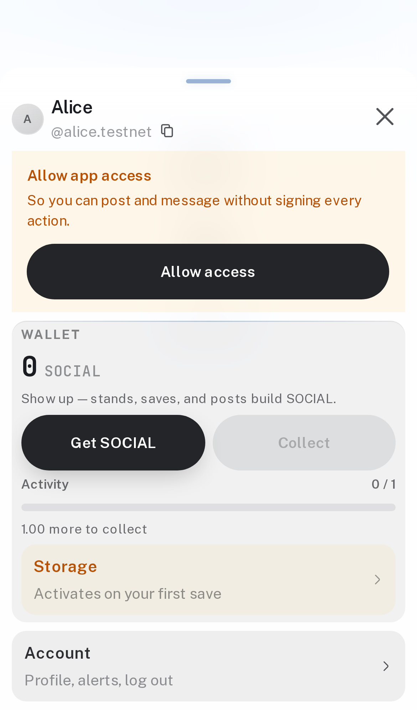
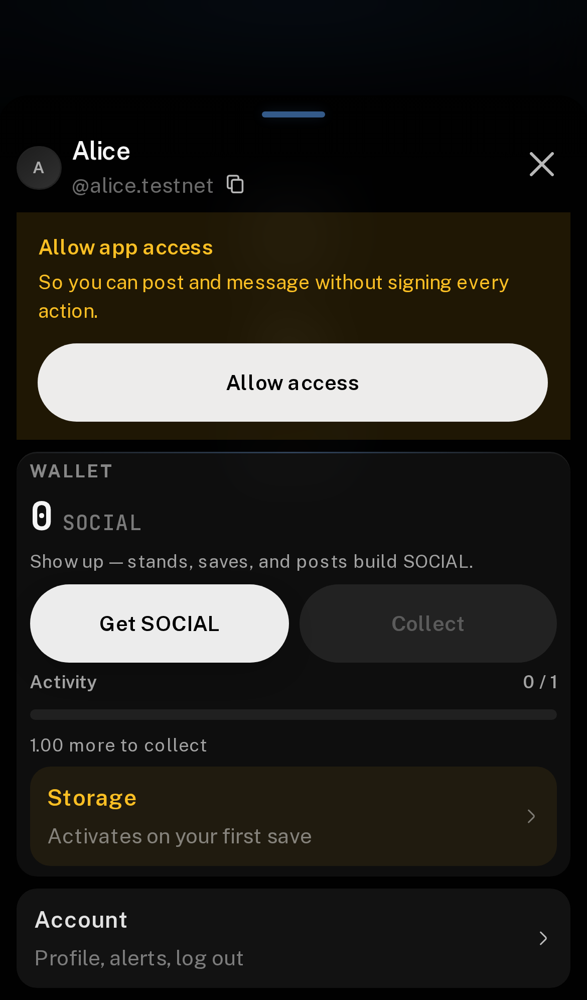
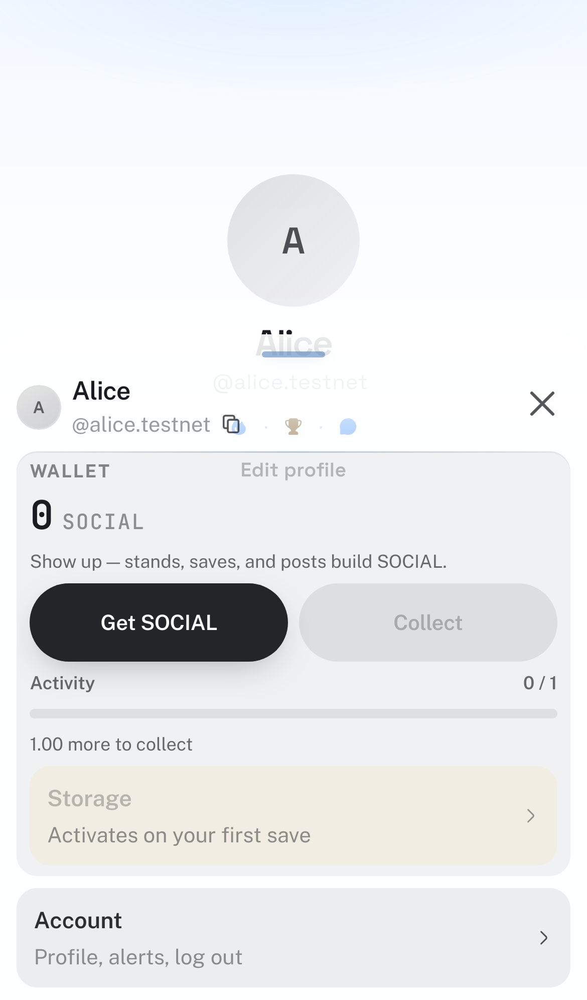
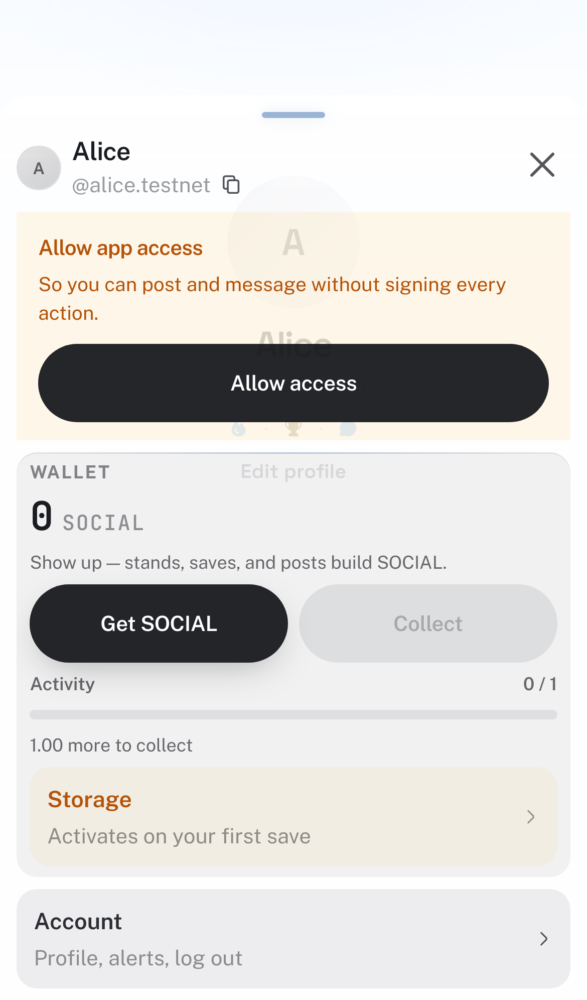
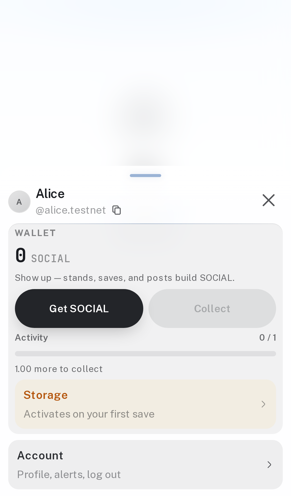
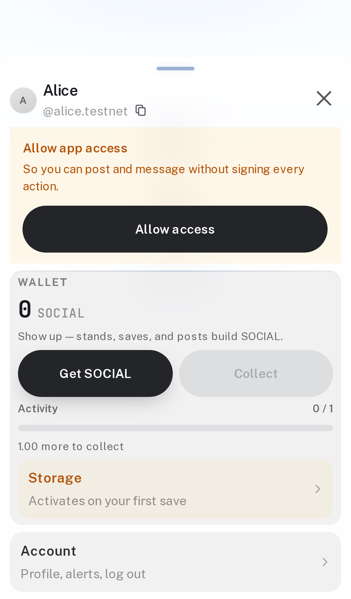
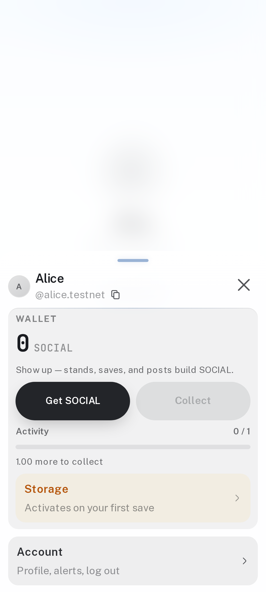
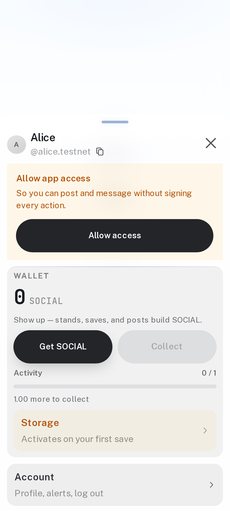
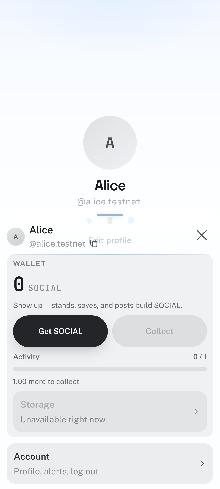
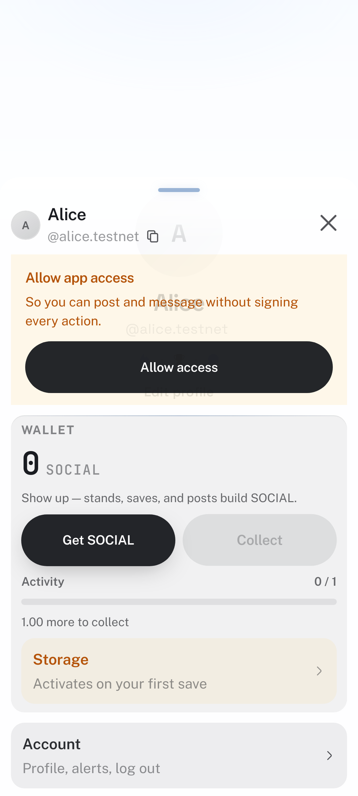
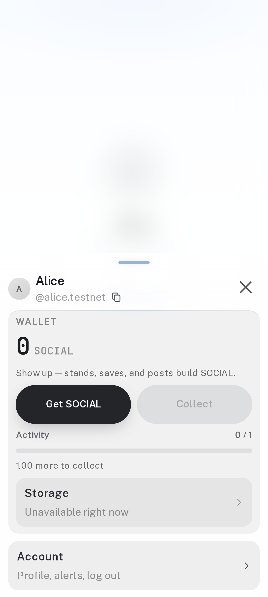
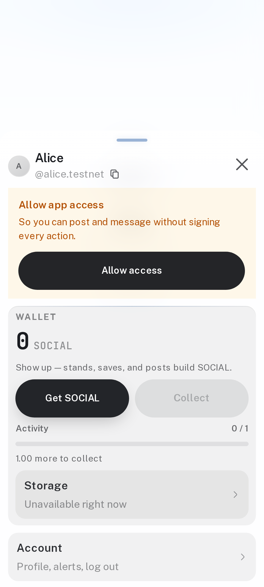
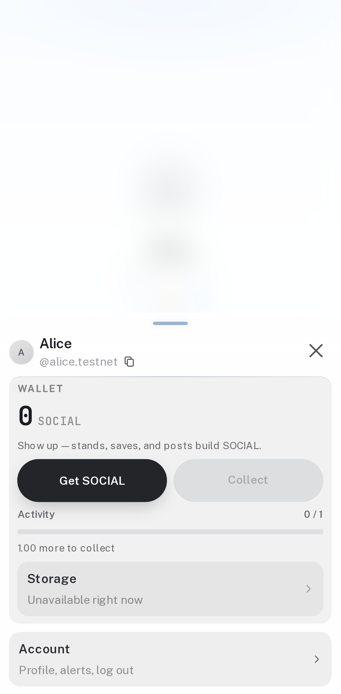

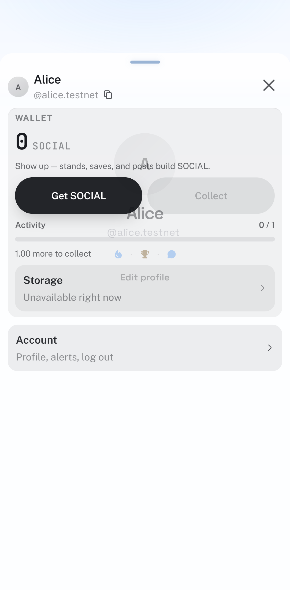
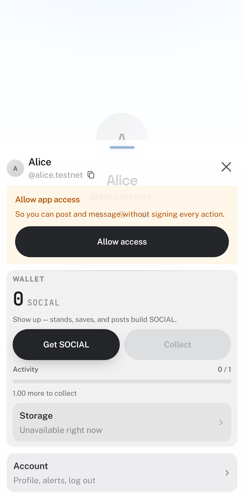

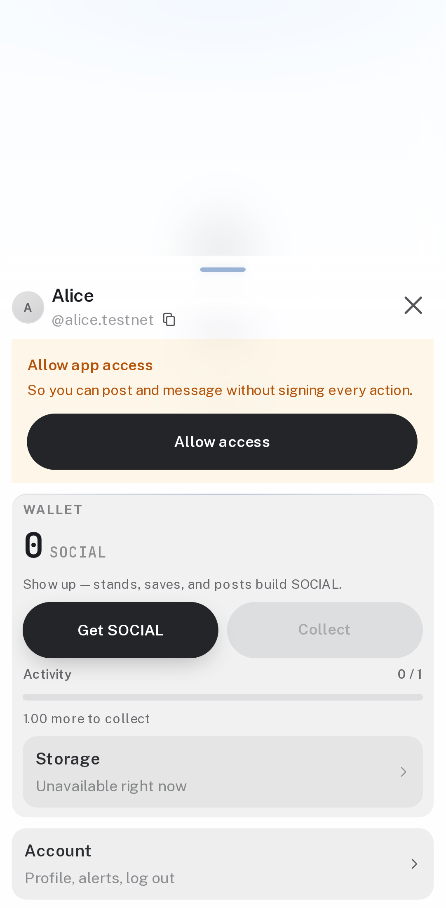

## 5. shipped

SDK: owner path `alice.near/` plans no `set_key_permission`; cross-account `bob.near/` and `apps/myapp/` still do; owner revoke is DeleteKey only; delegated revoke still clears the row. `bootstrapSession` for an owner path sends one AddKey, and sends nothing when AddKey is skipped.

App: `grantAppSocialSession` for `alice.testnet` signs one transaction whose only action is AddKey. The payload has no `execute_admin` and no `set_key_permission`. Renew of an on-account key does not call the wallet and moves `expiresAtMs` into the future. `grantCommunityAppSession` still signs AddKey plus `execute_admin` `set_key_permission`.

`mapAppAccessError` returns null for a user cancel. Gas, on-chain, contract, yocto, and `execute_admin` errors map to `Couldn't add app access. Try again in a moment.` or `Could not remove app access.` The sponsor tests throw when a non-drip response leaves the account under the threshold, return when a later read is funded, and wait out a real drip.

Route tests: a funded first visit with no stored hint bundles; an unfunded first visit does not; a known funded account still bundles; an empty known account still does not; the switch-wallet picker still does not. `walletMayBundleSessionKey` is true for a returning connect even when the flag is false, and true for a first visit only when the chosen wallet supports `signInWithFunctionCallKey`.

Banner copy tests: hidden while unsettled, Allow when missing, Renew when expired, hidden when active.

The drawer uses the tall hug cap so the Account row stays in the first paint. The notice uses the kit pad, ink on the title and the body, and `disabled` while the grant is pending. Screenshots are the 18 device shots plus the dark iPhone Chrome shot. The branch against `main` is 47 files, +1636 / −230.

`pnpm check:push` ran through the pre-push hook, not `--no-verify`. The Job 2 hook (head `44001a85`) passed with Playwright 383 passed, 5 flaky, 1 skipped. The Job 3 hook passed with 508 test files, 3544 unit tests, and Playwright 389 passed, 1 flaky, 1 skipped. The remaining flake is the collection supply line matching two nodes. The banner and this audit go out on the next push of this branch.
